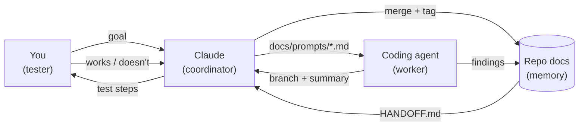

# Trooper's Coordinator Skills

[](https://github.com/Trooper-code/Trooper-s-Coordinator-Skills/actions/workflows/ci.yml)
[](LICENSE)

Two skills for agentic coding with **two agents**: an expensive model that thinks and a cheaper one that does the
heavy work. They keep context small, cut token use, and make sure nothing you learn is lost between chats.

- **Claude is the coordinator.** It plans, writes prompts, reviews, merges and tags.
- **A coding agent does the grunt work**: research, tracing, investigations, big fixes. I use Antigravity with
  Gemini, but any agent that can work on a git branch fits.
- **The repo is the memory.** Findings, status and the next step live in committed docs, so any new chat can pick
  up from one small file.

## The skills

| Skill | What it does |
|-------|--------------|
| [`agent-coordinator`](skills/agent-coordinator/SKILL.md) | Makes Claude act as the coordinator: writes self-contained prompts for the coding agent, reviews its branches (bugs → gaps → nitpicks), merges and tags. Keeps Claude out of context-heavy investigations. |
| [`project-handoff`](skills/project-handoff/SKILL.md) | Ends a session cleanly: writes every finding to the repo docs, rewrites a short `docs/HANDOFF.md`, and commits, so the next chat starts with full context from one small paste. |

They work on their own, but they're built to be used together.

## How it works



1. Claude breaks the goal into milestones and writes a prompt to `docs/prompts/`.
2. The agent works on its own branch, writes findings into the docs, and reports back. **It never merges.**
3. Claude re-runs the tests, spot-checks the agent's claims against the real files, and gives you test steps.
4. It works → Claude merges and tags it. It doesn't → Claude writes the follow-up prompt.
5. When the chat gets long, Claude updates `docs/HANDOFF.md` and you start a fresh chat from it.

## The memory model

The models never learn your project; their weights are fixed. All project memory lives in the repo, in three
tiers that work like the memory in a recurrent neural network:

| Tier | File | Size | Works like |
|------|------|------|------------|
| Working memory | the chat's context | up to the model's limit | activations in one forward pass |
| Short-term state | `docs/HANDOFF.md` | ~100 lines | an RNN/LSTM hidden state passed to the next step |
| Long-term memory | research docs, `MILESTONES.md` | unbounded, versioned | external memory (Neural Turing Machine, RAG) |

Each chat is one time step: `HANDOFF(n+1) = Claude(agent_summary(n), HANDOFF(n), research_docs)`. The handoff
rules map onto an LSTM's gates: a size budget and pruning (**forget**), findings written to the research docs first
(**input**), and "First thing to do" / "Read first" lists that expose only what the next step needs (**output**).

**Why it saves tokens:** a chat re-reads its whole context every turn, so a chat of `N` turns costs about
`k·N²/2` input tokens. That grows with the square of its length. Splitting the same work into `m` handoff-linked
chats cuts that to about `k·N²/(2m)`. Investigations, the biggest context consumers, run in the agent's context,
and Claude only reads summaries.

**Why it stays correct:** every finding is labeled **confirmed**, **unverified** or **wrong**, with evidence.
That stops one bad "fact" from being carried into every later session, the same way an error in a hidden state
carries forward.

Full write-up: [Memory Model](https://github.com/Trooper-code/Trooper-s-Coordinator-Skills/wiki/Memory-Model) on
the wiki.

## Install

**Claude apps (claude.ai / desktop / mobile)**: download a skill's `.zip` from the
[latest release](https://github.com/Trooper-code/Trooper-s-Coordinator-Skills/releases/latest) and upload it in
your skills settings. Do it once per skill.

**Claude Code**: copy the folders from `skills/` into `~/.claude/skills/` (all your projects) or
`<your-project>/.claude/skills/` (one project).

**Already have a skill with the same name?** Rename the folder and the `name:` line in its `SKILL.md` first, or
the two will clash. Skill names can't contain "claude" or "anthropic".

## Quick start

1. Copy the files from [`templates/`](templates) into your project: `HANDOFF.md` and `MILESTONES.md` go in
   `docs/`, and `PROMPT.md` is the format for files in `docs/prompts/`.
2. Tell Claude what you want to build. It splits the work into milestones and writes the first prompt.
3. Give your coding agent the one-line instruction Claude hands you, e.g.
   "Read and follow `docs/prompts/M1-save-format.md`".
4. Paste the agent's summary back to Claude. It reviews the branch and gives you test steps.
5. When the chat gets long, say **"update the handoff"**, then start a new chat and paste `docs/HANDOFF.md`.

**Full guide:** the [wiki](https://github.com/Trooper-code/Trooper-s-Coordinator-Skills/wiki) covers the whole
workflow, writing prompts, reviewing agent work, handoffs and the memory model.

## Repo layout

```
skills/
  agent-coordinator/SKILL.md
  project-handoff/SKILL.md
templates/
  HANDOFF.md        -> your docs/HANDOFF.md
  MILESTONES.md     -> your docs/MILESTONES.md
  PROMPT.md         -> your docs/prompts/<MILESTONE>-<slug>.md
docs/wiki/          source of the wiki pages
scripts/validate.py checks skills and links (runs in CI)
.github/workflows/  CI, plus release zips on tags
```

## Contributing

Issues and pull requests are welcome, especially if you adapt these for another coding agent (Codex, Cursor,
another Claude) and want to share what you changed.

Before opening a PR, run:

```
python scripts/validate.py
```

It checks that every skill's `name` and `description` will be accepted by claude.ai and Claude Code, and that
every link in the README, templates and wiki resolves. CI runs the same check.

**Releasing:** push a tag like `v1.1.0`. CI validates, builds an upload-ready `.zip` per skill, and attaches them
to a GitHub Release.

## License

[MIT](LICENSE). Use them, change them, share them.
