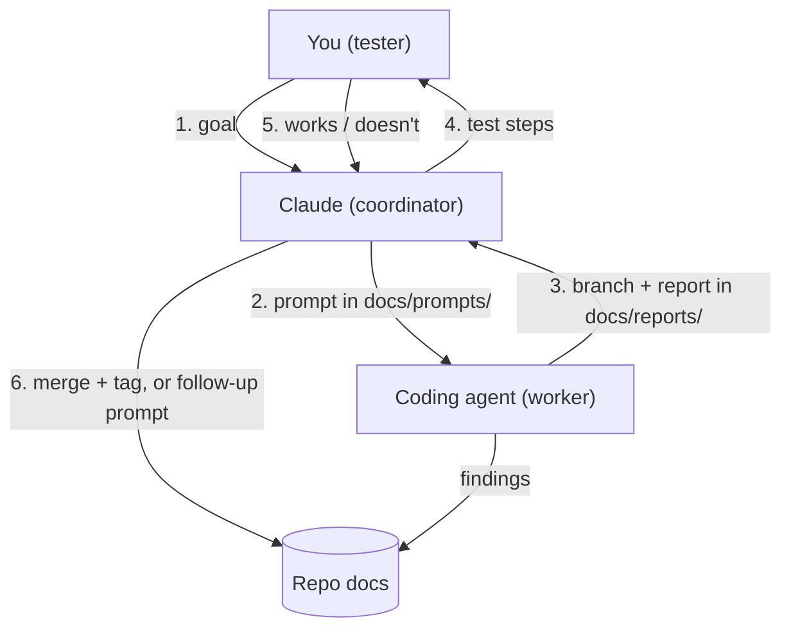
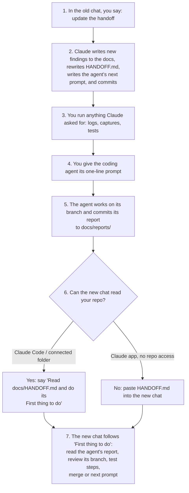

# Trooper's Coordinator Skills

[](https://github.com/Trooper-code/Trooper-s-Coordinator-Skills/actions/workflows/ci.yml)
[](LICENSE)

Two skills for agentic coding with **two agents**: an expensive model that thinks and a cheaper one that does the
heavy work. They keep context small, cut token use, and make sure nothing you learn is lost between chats.

- **Claude is the coordinator.** It plans, writes prompts, reviews, merges and tags.
- **A coding agent does the grunt work**: research, tracing, investigations, big fixes. I use Antigravity with
  Gemini, but any agent that can work on a git branch fits.
- **The repo is the memory.** Findings, status, agent reports and the next step live in committed docs, so any new
  chat can pick up from one small file.

## Why I built this: memory, the way neural networks do it

This started from a problem every long AI project hits: **chats forget.** The longer a chat runs, the slower and
pricier it gets, and the more it loses track of things said early on. Starting a new chat fixes the cost but
throws away everything it learned. With two agents it's worse, because neither one sees what the other knows.

Then I noticed something about the models themselves: **their weights never change while you use them.** Claude
and Gemini don't learn your project. Anything they "know" about it has to be loaded into the chat every time. So
the real question wasn't how to make the model remember, but **where the memory should live, and how it should
work.**

Neural networks already have good answers to that question, so I borrowed them:

| How neural networks handle memory | How this workflow does it |
|-----------------------------------|---------------------------|
| A **recurrent network (RNN)** processes a sequence one step at a time, passing a small *hidden state* to the next step. | Each chat is one step. `docs/HANDOFF.md` is the hidden state: small, current, and handed to the next chat. |
| An **LSTM** uses *gates* to decide what to forget, what to write, and what to pass on. | The handoff rules: a size budget and pruning (forget), findings written to the research docs first (write), and "First thing to do" / "Read first" lists (pass on). |
| **Memory-augmented networks** (Neural Turing Machines, RAG) keep a large *external memory* the model reads and writes through addresses. | The research docs, milestone board and agent reports are the external memory. HANDOFF.md and prompts point to exact sections instead of copying them. |
| An error in a hidden state **carries forward** into every later step. | Every finding is labeled **confirmed / unverified / wrong** with evidence, so a bad "fact" gets caught instead of spreading. |

**This is a design borrowed from neural networks, not a neural network.** Nothing here is trained and nothing
learns on its own. The "gates" are written rules and check scripts that Claude follows: plain files in your repo.
Where the comparison stops is spelled out on the
[Inspiration](https://github.com/Trooper-code/Trooper-s-Coordinator-Skills/wiki/Inspiration#where-the-comparison-stops) wiki page.

**Why this helps agentic work:**
- **Cheaper.** A chat re-reads its whole context every turn, so cost grows with the *square* of its length. Many
  short chats linked by a small handoff cost far less than one long one.
- **Two agents, one memory.** Claude and the coding agent read and write the same repo docs, so neither has to
  be told what the other found.
- **Nothing is lost.** Every finding is committed. A new chat, a different model, or a stranger forking the repo
  starts from the same memory.
- **Better than neural memory in one way:** it's plain text. You can read it, check it, fix it, and roll it back
  with git. A network's memory is millions of numbers nobody can read.

The full technical version, with the gate mapping and the token math, is on the
[Memory Model](https://github.com/Trooper-code/Trooper-s-Coordinator-Skills/wiki/Memory-Model) wiki page. The
story behind it is on [Inspiration](https://github.com/Trooper-code/Trooper-s-Coordinator-Skills/wiki/Inspiration).

## The skills

| Skill | What it does |
|-------|--------------|
| [`agent-coordinator`](skills/agent-coordinator/SKILL.md) | Makes Claude act as the coordinator: sets up new or existing projects (including an `AGENTS.md` rules file tailored to your coding agent), writes self-contained prompts, reviews the agent's branches and reports (bugs → gaps → nitpicks), merges and tags. Also imports deep-research results as checkable claims and cuts releases with written notes. Keeps Claude out of context-heavy investigations. |
| [`project-handoff`](skills/project-handoff/SKILL.md) | Ends a session cleanly: writes every finding to the repo docs, rewrites a short `docs/HANDOFF.md`, checks it with `check-handoff.py`, and commits, so the next chat starts with full context from one small file. |

They work on their own, but they're built to be used together.

**New in v1.4.0:** [release mode](#release-mode-no-more-hand-written-release-notes) writes your changelog and release notes, [research import](#research-import-deep-research-as-leads-not-facts) turns deep-research reports into checkable claims, a [copyright guard](#copyright-guard) blocks ROMs and saves before they're committed, and confirmed facts now [remember the tool versions](#version-aware-facts) they were proven on. Plus a decisions log, a research index, [agent profiles](#agent-profiles) and [seven check scripts](#the-check-scripts). See the [changelog](CHANGELOG.md).

## How it works

The workflow has two loops: the **work loop** inside one chat, and the **handoff** that carries everything into
the next chat.

### Inside a session: the work loop



1. You give Claude the goal. Claude splits it into milestones in `docs/MILESTONES.md`.
2. Claude writes a self-contained prompt to `docs/prompts/<MILESTONE>-<slug>.md` and gives you one line to paste
   into the agent.
3. The agent follows `AGENTS.md` plus its prompt, works on its own branch, writes findings into the docs, and commits
   a report to `docs/reports/`. **It never merges.** If it gets stuck, it stops and reports instead of burning quota.
4. You tell Claude it's done. Claude reads the report from the branch, checks the tool versions, re-runs the tests,
   spot-checks the claims against the real files, and gives you exact test steps.
5. You test on your machine and report back.
6. It works → Claude merges and tags it. It doesn't → Claude turns the bugs and gaps into the next prompt (or, after
   two failed rounds, abandons the branch and restarts from the last good tag).

### Between sessions: the handoff

Chats get slower, pricier and more forgetful as they grow. Instead of keeping one chat alive, you end it on
purpose and start the next one from `docs/HANDOFF.md`.



**When to hand off**
- At the end of every work session.
- After each review round (step 6 above), before the agent starts the next prompt.
- Whenever the chat feels long or slow. Claude should suggest it on its own.

**How to do it**
1. In the old chat, say **"update the handoff"**. Claude records anything not yet in the docs, rewrites
   `HANDOFF.md`, runs `scripts/check-handoff.py` (size, sections, broken paths), and commits. It tells you what to
   run (logs, captures) and gives you the agent's next prompt line.
2. Run what it asked for, and give the agent its prompt.
3. When the agent is done, open a new chat. If it can read your repo, just say
   `Continue my project. Read docs/HANDOFF.md and do its "First thing to do".` Otherwise, paste `docs/HANDOFF.md`.
4. The new chat reads the docs `HANDOFF.md` points to, reads the agent's report from its branch, then does its
   **First thing to do**: usually reviewing that report.

**If your agent can't commit a report** (no git access, say), paste its summary into the old chat instead. Claude
puts it at the bottom of `HANDOFF.md`, commits, and gives you the one-line starter for the new chat.

**What's in `HANDOFF.md`** (template: [`templates/HANDOFF.md`](templates/HANDOFF.md))

| Section | What the new chat gets from it |
|---------|--------------------------------|
| Setup | Tools, the coding agent, and where every folder is |
| Tool versions | Exact versions the project is pinned to; the agent's report is checked against them |
| How it works now | The current confirmed state, and which tag holds it |
| Where it stops | The latest real test result and the log that shows it |
| In progress | Who's doing what: prompt path, branch, and where its report will be |
| Rules | Project constraints, one line each |
| First thing to do | Exact steps to start with, so the chat doesn't have to guess |
| Lessons | Traps already hit, so they aren't hit again |
| Agent summary line | A pointer to the agent's report, or its pasted summary if it couldn't commit one |

It stays around **100 lines**. History goes in `MILESTONES.md`, findings go in the research docs, and
`HANDOFF.md` only points to them. A small handoff makes a new chat cheap to start.

## What keeps the agent on track

### AGENTS.md: the agent's standing rules

Every project gets an `AGENTS.md` at its root (template: [`templates/AGENTS.md`](templates/AGENTS.md)). Most
coding agents load it automatically at the start of every task, and every prompt also lists it under "Read first",
so it's read either way. It holds the rules that never change between tasks:

- **Always:** work only on the named branch, label every finding confirmed / unverified / wrong with evidence, keep
  line endings.
- **Never:** merge or tag, commit copyrighted or third-party files, or touch real user data, logs or ports in tests.
- **Tool versions**, **stop conditions** and the **report format** (below).
- **Agent-specific constraints.** When you name your coding agent, Claude writes a section just for that app:
  - how it loads rules (if it reads a different file, like `GEMINI.md` or `.cursor/rules/`, Claude adds a pointer
    there);
  - which of its tools to use for what;
  - permission limits for high-privilege tools (e.g. a reverse-engineering toolkit stays read-only on game files);
  - known quirks.
  Claude asks which tools you actually have rather than guessing, and marks anything it isn't sure of as unverified.

Because the standing rules live in one file, prompts only carry what's specific to their task. They're shorter, and
a rule can't be forgotten in one of them.

### Agent reports: no more pasting

When the agent finishes (or stops), it writes `docs/reports/<MILESTONE>-<slug>.md` and commits it on its branch
(format: [`templates/REPORT.md`](templates/REPORT.md)): status, tool versions, what changed, findings with evidence,
test output, and open questions. Claude reads it straight from the branch, so you don't copy-paste summaries
between apps, and the report merges into the repo's history with the branch.

### Stop conditions and the abandon rule

The agent **stops and reports** instead of burning quota when:
- the same fix has failed 3 times;
- it needs a file, tool or permission it doesn't have;
- what it finds contradicts a fact marked confirmed;
- the task turns out much bigger than the prompt expected.

Each prompt can add its own stop conditions. On review, Claude decides what the agent needs and writes that into
the next prompt, rather than redoing the work.

When a branch **fails two review rounds** or is heading the wrong way, Claude abandons it instead of patching
again. It keeps the branch for reference, records why as a lesson, keeps any confirmed findings, and writes a fresh
prompt from the **last good tag**.

### Tool versions

`HANDOFF.md` has a **Tool versions** table: compiler, SDK, emulator, loaders, mods, whatever a mismatch could break.
The agent records the versions it used in its report, and Claude checks them first on review. A mismatch is treated
as a bug until explained. Version mismatches are one of the most common causes of "works on my machine" bugs.

### The check scripts

Seven small scripts in [`templates/scripts/`](templates/scripts) go in your project's `scripts/` folder. Claude runs
them at the right moments, and you can run them yourself. They need Python 3.9 or newer and nothing else, and each
problem they print says how to fix it.

| Script | When it runs | What it catches |
|--------|--------------|-----------------|
| `check-prompt.py` | after Claude writes an agent prompt | missing sections, `AGENTS.md` not first, unlabeled facts, leftover placeholders |
| `check-report.py` | first step of every review | no status, a stop with no reason, findings without a label or evidence, tests without output |
| `check-research.py` | on review, and when tool versions change | facts proven on older tool versions; broken research index entries |
| `check-handoff.py` | before every handoff commit | over budget, missing sections, dead paths; lessons that should become rules |
| `check-safe-to-publish.py` | pre-commit hook and CI | ROMs, disc images, console executables, saves, big binaries |
| `release-notes.py` | release mode and the release workflow | prints a version's `CHANGELOG.md` section as release notes |
| `detect-mode.py` | before kickoff or adopt | which mode a repo needs, and which workflow files it has or is missing |

### Status mode

Back after a week? Ask for a status instead of starting a full session:
```
Use agent-coordinator. Status.
```
Claude reads only `MILESTONES.md` and `HANDOFF.md` and answers in about five lines: where things stand, who's on
what, the last test result, and what's next.

## Built for the long haul

### Release mode: no more hand-written release notes

```
Use agent-coordinator. Release v1.4.0.
```
Claude:
- collects what changed since the last tag from the milestone board, the merged agent reports and the git log;
- writes the `CHANGELOG.md` entry for your users, with an Upgrading section when they need to do something;
- tags the release, or hands you the two commands if it can't push tags.

The release workflow ([`templates/github/workflows/release.yml`](templates/github/workflows/release.yml)) then
creates the GitHub Release with that changelog section as its notes, and attaches your build. The skills in this repo
are released the same way.

### Research import: deep research as leads, not facts

```
Use agent-coordinator. Import research:
<paste the Gemini Deep Research / ChatGPT / Perplexity results>
```
Claude splits the report into individual claims and files them in the right research sections, each labeled
**unverified** with its source.
- A claim that **contradicts a confirmed fact** is listed as a conflict for you, never filed as true.
- A claim that matches a known fact adds a source to it instead of making a duplicate.
- The claims the next milestone depends on go into a **verify prompt** for the coding agent, which proves or
  disproves each one with evidence.

### Copyright guard

[`check-safe-to-publish.py`](templates/scripts/check-safe-to-publish.py) runs as a pre-commit hook
([`templates/hooks/pre-commit`](templates/hooks/pre-commit)) and in CI
([`templates/github/workflows/checks.yml`](templates/github/workflows/checks.yml)). It blocks:
- ROMs, disc images, console executables and packages, save files and emulator states;
- any binary over 5 MB.

Install the hook once per clone with `cp scripts/hooks/pre-commit .git/hooks/pre-commit`. It explains each block
in plain English and how to fix it. Intentional exceptions, like a tiny test file you made from
scratch, go in `.publish-allowlist` with a comment saying why. It checks names, sizes and contents that look
binary, so it catches accidents, not someone determined to get around it.

### Version-aware facts

A confirmed finding records what it was proven on:
```
Save header is 0x40 bytes. [confirmed @ m3-p1 | xenia-canary=1.2.3, dotnet=8.0.1]
```
When the Tool versions table in `HANDOFF.md` changes (a new emulator build, say), `check-research.py` lists every
fact proven on the old version, and Claude puts re-checking them into the next prompt. "Confirmed" stays true
across updates, instead of quietly going stale.

### Decisions log and research index

- [`docs/DECISIONS.md`](templates/DECISIONS.md) keeps one short entry per real decision: what was chosen, what was
  rejected, why, and what would change the answer. New chats read it instead of reopening settled questions, and
  new facts get a new entry rather than a rewrite of history.
- [`docs/research/INDEX.md`](templates/research/INDEX.md) has one line per research topic, linking to its file and
  section. Claude and the agent look things up there first instead of skimming every doc, and `check-research.py`
  catches entries that point nowhere.

### Lessons become rules

A lesson hit a second time gets `(x2)` in `HANDOFF.md`. The handoff checker flags it, and Claude moves it into
`AGENTS.md`, a check script or the prompt template. The Lessons list stays short, and fixed problems stay fixed.

### Agent profiles

[`templates/agents/`](templates/agents) has ready-made agent-specific sections for **Antigravity**, **Codex**,
**Claude Code** and **Cursor**, plus a generic one to fill in. Each says how that agent loads rules, its tools, its
permission limits and its quirks, with every fact labeled confirmed or unverified. Claude starts from the profile
instead of asking from scratch. Profiles for other agents are welcome as pull requests.

## The memory model

The models never learn your project; their weights are fixed. All project memory lives in the repo, in three
tiers that work like the memory in a recurrent neural network:

| Tier | File | Size | Works like |
|------|------|------|------------|
| Working memory | the chat's context | up to the model's limit | activations in one forward pass |
| Short-term state | `docs/HANDOFF.md` | ~100 lines | an RNN/LSTM hidden state passed to the next step |
| Long-term memory | research docs, `MILESTONES.md` | unbounded, versioned | external memory (Neural Turing Machine, RAG) |

Each chat is one time step: `HANDOFF(n+1) = Claude(agent_summary(n), HANDOFF(n), research_docs)`. The handoff
rules map onto an LSTM's gates: a size budget and pruning (**forget**), findings written to the research docs first
(**input**), and "First thing to do" / "Read first" lists that expose only what the next step needs (**output**).

**Why it saves tokens:** a chat re-reads its whole context every turn, so a chat of `N` turns costs about
`k·N²/2` input tokens. That grows with the square of its length. Splitting the same work into `m` handoff-linked
chats cuts that to about `k·N²/(2m)`. Investigations, the biggest context consumers, run in the agent's context,
and Claude only reads summaries.

**Why it stays correct:** every finding is labeled **confirmed**, **unverified** or **wrong**, with evidence.
That stops one bad "fact" from being carried into every later session, the same way an error in a hidden state
carries forward.

Full write-up: [Memory Model](https://github.com/Trooper-code/Trooper-s-Coordinator-Skills/wiki/Memory-Model) on
the wiki.

## Install

**Claude apps (claude.ai / desktop / mobile)**: download a skill's `.zip` from the
[latest release](https://github.com/Trooper-code/Trooper-s-Coordinator-Skills/releases/latest), then in Claude go to
**Customize → Skills → + → Create skill → Upload a skill** and pick the zip. Do it once per skill. Uploaded skills
are private to your account; check each one is switched on in that list.

**Claude Code**: unzip each skill's `.zip` from the
[latest release](https://github.com/Trooper-code/Trooper-s-Coordinator-Skills/releases/latest) into
`~/.claude/skills/` (all your projects) or `<your-project>/.claude/skills/` (one project). The zips include the
`templates/` folder the skill copies from. Installing from a clone instead? Copy each folder from `skills/`, then
copy the repo's `templates/` folder into each one (e.g. `~/.claude/skills/agent-coordinator/templates/`).

**Already have a skill with the same name?** Rename the folder and the `name:` line in its `SKILL.md` first, or
the two will clash. Skill names can't contain "claude" or "anthropic".

## Where everything goes

There are two kinds of files here: the **skills**, which go where Claude can load them, and the **project files**,
which go in each of your project repos. Claude copies the project files in for you at kickoff or adopt; this table is
for when you set things up by hand or want to check.

**The skills (for Claude):**

| You use | Put the skills here |
|---------|---------------------|
| Claude apps (claude.ai, desktop, mobile) | Upload each skill's zip from the [latest release](https://github.com/Trooper-code/Trooper-s-Coordinator-Skills/releases/latest) in **Customize → Skills** |
| Claude Code, every project | `~/.claude/skills/agent-coordinator/` and `~/.claude/skills/project-handoff/` (on Windows: `%USERPROFILE%\.claude\skills\`) |
| Claude Code, one project | `<your-project>/.claude/skills/agent-coordinator/` and `.../project-handoff/` |

**Your project:**

```
your-project/
  AGENTS.md                      the coding agent's standing rules (+ its agent-specific section)
  CHANGELOG.md                   release notes come from here
  .publish-allowlist             (optional) files the copyright guard should allow
  docs/
    HANDOFF.md                   the short index a new chat starts from
    MILESTONES.md                status board
    DECISIONS.md                 decisions log
    research/
      INDEX.md                   one line per research topic
      *.md                       your research docs
    prompts/                     agent prompts, one per task
    reports/
      TEMPLATE.md                the report format; agents commit their reports here
  scripts/                       the check scripts  <- or docs/scripts/, see below
    check-handoff.py   check-research.py   check-report.py   check-prompt.py
    check-safe-to-publish.py   release-notes.py   detect-mode.py
    hooks/pre-commit             a copy of the hook, kept in the repo
  .github/workflows/
    checks.yml                   copyright guard + handoff check on every push
    release.yml                  creates releases from CHANGELOG.md when you push a tag
  .git/hooks/pre-commit          the installed hook (not committed; copy it here once per clone)
```

**`scripts/` or `docs/scripts/`: your choice.** Put the check scripts in `scripts/` at the repo root (the default),
or in `docs/scripts/` if you'd rather keep everything for the workflow under `docs/`. Claude looks in both and uses
whichever your project has. So do the pre-commit hook and both workflows, so nothing needs editing. Pick one per
project and don't split the scripts between them.

To install the hook after cloning, run one of these from the repo root:
```
cp scripts/hooks/pre-commit .git/hooks/pre-commit
cp docs/scripts/hooks/pre-commit .git/hooks/pre-commit
```
On Windows PowerShell, `Copy-Item` works the same way.

## Quick start

### Start a new project

Open a fresh chat and start it with the kickoff command:

**Claude Code** (skills are slash commands there):
```
/agent-coordinator Start a new project: <name>. Repo: <GitHub URL or folder>. Goal: <what you want to build>. Coding agent: <Antigravity / Codex / ...>.
```

**Claude apps** (claude.ai / desktop / mobile), paste:
```
Use agent-coordinator. Start a new project: <name>. Repo: <GitHub URL or folder>. Goal: <what you want to build>. Coding agent: <Antigravity / Codex / ...>.
```

Claude then:
1. asks for repo access, and 1–3 questions only if the goal is unclear;
2. asks which tools your coding agent has, and writes `AGENTS.md` with a section for that agent;
3. scaffolds `docs/MILESTONES.md`, `docs/HANDOFF.md` (with a tool-versions table), `docs/DECISIONS.md`,
   `docs/research/INDEX.md`, `docs/prompts/`, `docs/reports/TEMPLATE.md`, `CHANGELOG.md`, the check scripts, the
   copyright-guard hook, and CI and release workflows (from [`templates/`](templates));
4. plans the milestones and writes the first agent prompt;
5. commits, and gives you the one line to paste into your coding agent.

From there it's the work loop: tell Claude when the agent is done, test, merge or retry.

### Add it to an existing project

Already have a project with code and docs, but no `HANDOFF.md`? Open a fresh chat and adopt it:

**Claude Code:**
```
/agent-coordinator Adopt my existing project. Repo: <GitHub URL or folder>. Coding agent: <Antigravity / Codex / ...>.
```

**Claude apps:**
```
Use agent-coordinator. Adopt my existing project. Repo: <GitHub URL or folder>. Coding agent: <Antigravity / Codex / ...>.
```

Claude then:
1. **Scans** your README, `docs/`, notes like `TODO.md` / `ROADMAP.md` / `CHANGELOG.md`, existing agent rules files,
   the build and test setup (including tool versions), recent commits, branches and tags. It reads; it doesn't trace code (about 15–20 tool calls).
2. **Inventories** what you already have against what the workflow needs, and uses your existing files where they
   fit (an existing roadmap gets linked from `MILESTONES.md`, not copied).
3. **Creates only the missing files**: `AGENTS.md` (or adds the missing sections to your existing rules file),
   `docs/MILESTONES.md`, `docs/HANDOFF.md`, `docs/DECISIONS.md`, `docs/research/INDEX.md` (indexing your existing
   research), `docs/prompts/`, `docs/reports/TEMPLATE.md`, the check scripts and workflows. It never overwrites,
   moves or renames your files.
4. **Runs the copyright guard** over the whole repo, and tells you first if anything already committed is flagged.
   Removing a file from history is your call.
5. **Labels what it learned**: anything taken from existing docs is *unverified* until tested.
6. **Plans ahead** from what it found (half-done branches, failing tests, TODOs, research gaps), asking 1–3 questions
   only when the direction is a real judgment call.
7. **Writes the first agent prompt.** If big parts of the code are undocumented, that's an *M0 survey* that has the
   agent map them into `docs/research/`.
8. **Commits** the new docs in one commit and gives you a summary, the plan, and the line to paste into your agent.

You don't have to pick the right command: if the repo already has `docs/HANDOFF.md`, either command just continues
from it.

### Continue an existing project

Start a fresh chat with your `docs/HANDOFF.md` (see [the handoff](#between-sessions-the-handoff)), or in a chat
that can read your repo:
```
Continue my project. Read docs/HANDOFF.md and do its "First thing to do".
```

Just want to know where things stand? `Use agent-coordinator. Status.`

### Other commands

| Say | What happens |
|-----|--------------|
| `Use agent-coordinator. Import research:` + paste | Deep-research results filed as unverified claims, conflicts flagged, a verify prompt for the agent |
| `Use agent-coordinator. Release v1.2.0.` | Changelog entry written, tagged, release notes generated by CI |
| `Use agent-coordinator. Status.` | Five-line status from two files |
| `Update the handoff.` | `project-handoff`: findings saved, `HANDOFF.md` rewritten and checked, committed |

**Full guide:** the [wiki](https://github.com/Trooper-code/Trooper-s-Coordinator-Skills/wiki) covers the whole
workflow, writing prompts, reviewing agent work, handoffs and the memory model.

## Repo layout

```
skills/
  agent-coordinator/SKILL.md
  project-handoff/SKILL.md
CHANGELOG.md        what changed in each release
skills/agent-coordinator/reference/
  release.md, research-import.md, scripts.md   detail for those modes
templates/                      copied into your project (bundled inside the release zips too)
  AGENTS.md                  -> AGENTS.md (repo root)
  HANDOFF.md                 -> docs/HANDOFF.md
  MILESTONES.md              -> docs/MILESTONES.md
  DECISIONS.md               -> docs/DECISIONS.md
  research/INDEX.md          -> docs/research/INDEX.md
  PROMPT.md                  -> docs/prompts/<MILESTONE>-<slug>.md
  REPORT.md                  -> docs/reports/TEMPLATE.md
  scripts/*.py               -> scripts/ (the seven check scripts)
  hooks/pre-commit           -> scripts/hooks/pre-commit, installed into .git/hooks/ (copyright guard)
  github/workflows/*.yml     -> .github/workflows/ (checks, release)
  agents/*.md                   agent profiles for the AGENTS.md agent-specific section
docs/wiki/                      source of the wiki pages
scripts/validate.py             checks skills, the files they mention, and every link (CI)
tests/                          script tests (CI) and SCENARIOS.md, the manual skill checklist
.github/workflows/ci.yml        CI, plus release zips and changelog notes on tags
```

## Contributing

Issues and pull requests are welcome, especially if you adapt these for another coding agent (Codex, Cursor,
another Claude) and want to share what you changed.

Before opening a PR, run:

```
python scripts/validate.py
python tests/test_check_handoff.py
python tests/test_scripts.py
```

- `validate.py` checks that every skill's `name` and `description` will be accepted by claude.ai and Claude Code,
  that every `templates/` or `reference/` file a skill mentions exists, and that every link resolves.
- The tests run each script against throwaway repos.
- What a skill makes Claude *do* can't run in CI. If you change a skill, walk through the matching rows of
  [`tests/SCENARIOS.md`](tests/SCENARIOS.md) in a fresh Claude chat.

**Releasing:** add a `## vX.Y.Z` section to `CHANGELOG.md`, then push the tag. CI validates, builds an
upload-ready `.zip` per skill with the templates bundled inside, and creates the GitHub Release with that changelog
section as its notes.

## License

[MIT](LICENSE). Use them, change them, share them.
