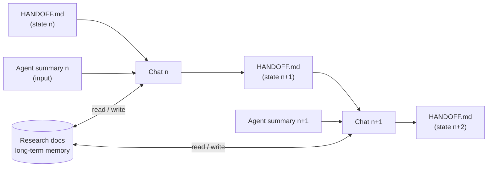

# Memory Model

*The story behind this page, in plain English: [[Inspiration]].*

The model's weights never change. Claude doesn't "learn" your project, and neither does Gemini. Every bit of
project memory lives in the repo, and each chat **loads** it. This page explains how that memory is laid out and
why, using the closest match from machine learning: recurrent and memory-augmented neural networks.

## Three tiers

| Tier | File(s) | Size | Lifetime | ML equivalent |
|------|---------|------|----------|---------------|
| Working memory | the chat's context window | up to the model's limit | one chat | activations inside one forward pass |
| Short-term state | `docs/HANDOFF.md` | ~100 lines / 10 KB | rewritten every session | RNN/LSTM hidden state `h_t` |
| Long-term memory | `docs/research/*.md`, `RESEARCH.md`, `MILESTONES.md`, `docs/reports/` | unbounded | permanent, versioned in git | external memory (Neural Turing Machine, RAG index) |

## A chat is one time step

A recurrent network processes a sequence one step at a time. At each step it takes an input plus the previous
hidden state, and outputs a new hidden state:

```
h_t = f(x_t, h_{t-1})
```

This workflow is the same loop, with a chat as one step:

```
HANDOFF_n+1 = Claude(agent_summary_n, HANDOFF_n, research_docs)
```



The agent's report (`docs/reports/`, committed on its branch) is the step's input `x_t`. That's why the handoff ends with
`[Paste the coding agent's latest summary here]`: the input slot for the next step.

## The LSTM gates, mapped

An LSTM (Long Short-Term Memory) controls its state with three gates. Each has a rule in `project-handoff`:

| Gate | What it does in an LSTM | The rule that does it here |
|------|-------------------------|----------------------------|
| **Forget gate** | Decides what to drop from the state | Keep HANDOFF.md near the budget. Merge duplicate lessons. Replace the reviewed agent summary with the placeholder. "How it works now" is rewritten, never appended. |
| **Input gate** | Decides what new information gets written | Findings go into the research docs **first**, marked confirmed / unverified / wrong, with evidence. Only the current state and next step go into HANDOFF.md. |
| **Output gate** | Decides what part of the state is exposed to the next step | "First thing to do" and the "Read first" list in agent prompts: the next step reads only what it needs. |

The size budget used to be only a rule Claude was asked to follow. Since v1.3.0, `scripts/check-handoff.py`
enforces it: the forget gate has a hard limit, and dangling pointers (output-gate addresses that lead nowhere) fail
the check.

There's one invariant the forget gate must respect: **before a fact is cut from HANDOFF.md, it must exist in the
research docs.** In ML terms, nothing leaves short-term state without being written to long-term memory first.
That's what makes forgetting safe.

## External memory: read and write heads

Memory-augmented networks (Neural Turing Machines, Differentiable Neural Computers) and retrieval systems (RAG)
keep a large store outside the model and access it through **read and write heads**. The model only ever holds
a small slice in working memory.

| Operation | Here |
|-----------|------|
| **Addressing** (where to read) | HANDOFF.md points at specific doc sections ("MILESTONES §4", "research/save-format.md §Header"). Prompts list exact files under "Read first". |
| **Read** | Claude or the agent opens only the pointed-to sections. |
| **Write** | Findings are written to the section they belong to, not appended as a session diary. That keeps the store addressable. |
| **Erase** | A claim proven false is marked **wrong** and corrected where it was written. |

A session diary is the failure mode: it's write-only memory. Nothing in it is addressable, so the next session
has to re-read everything to find anything.

## Why small state matters: token economics

A chat model re-reads the **entire** context on every turn. If each turn adds roughly `k` tokens, then:

- turn `n` costs about `n · k` input tokens;
- a chat of `N` turns costs about `k · N² / 2` tokens in total.

Cost grows with the **square** of chat length. Prompt caching lowers the price of re-read tokens, but they still
fill the context window. Quality also drops: models are measurably worse at using information buried in the
middle of a long context ("lost in the middle").

A handoff resets `n` to a small constant: one ~10 KB file plus the pointed-to sections. The cumulative cost
becomes a sum of many short chats instead of one long one:

```
one long chat:        k · N² / 2
m chats of N/m turns: m · k · (N/m)² / 2  =  k · N² / (2m)
```

Splitting the same work into `m` chats cuts the re-read cost by about a factor of `m`, as long as the handoff
itself stays small. That's why the handoff has a size budget.

The coordinator split saves tokens the same way. Investigations (large files, long traces, disassembly) are the
biggest context consumers, so they run in the agent's context, not Claude's. Claude only reads the agent's
**summary** and spot-checks it. The budget rule (~10 tool calls of new tracing, then hand it off) is a hard cap
on how much of Claude's context a review can use.

## Staleness: knowing when a memory expires
Neural memory can't tell when what it learned has stopped being true. This memory can:
- **Version-aware stamps:** confirmed facts record the tool versions they were proven on. `check-research.py`
  flags them when those versions change, so stale facts get re-checked instead of trusted.
- **The research index** is the external memory's address table: every topic has exactly one address, and dead
  addresses fail a check.
- **The decisions log** keeps *why* alongside *what*, so a later step doesn't undo a choice whose reasons it can't
  see.

## Truth labels: stopping error propagation

In a recurrent network, an error in the hidden state carries into every later step. Agent workflows have the same
failure mode: one wrong "fact" in a handoff gets trusted by the next chat, built on by the agent, and spread into
the code.

The **confirmed / unverified / wrong** labels are the defense:

- **unverified** facts can be used, but the next step knows to test them before building on them;
- **confirmed** needs evidence: a real run, a capture, emulation, a passing test. Reading code or docs is not
  enough;
- **wrong** fixes the record at the source, so the bad fact can't be reloaded later.

Neural memory can't do this. Its contents are distributed across weights and carry no confidence or source. This
memory is explicit text, so every claim can carry its evidence, and git keeps the full history of every change.

## Summary

| Neural network | This workflow |
|----------------|---------------|
| Weights (learned, fixed at inference) | The model (fixed; never learns your project) |
| Hidden state `h_t` | `docs/HANDOFF.md` |
| Input `x_t` | The coding agent's summary |
| Forget / input / output gates | Size budget and pruning / write findings first / "First thing to do" and "Read first" |
| External memory + read/write heads | Research docs + section pointers |
| Opaque, distributed, no provenance | Plain text, addressable, labeled, versioned |
